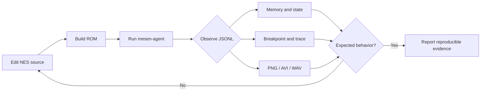
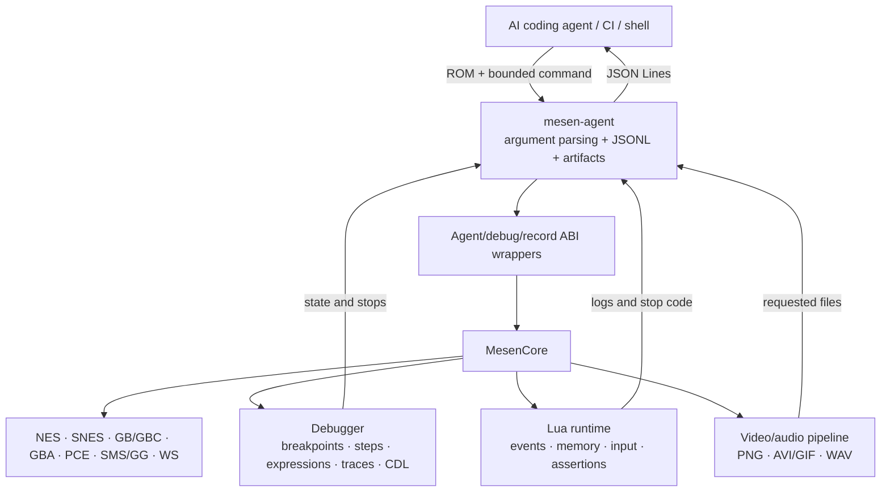
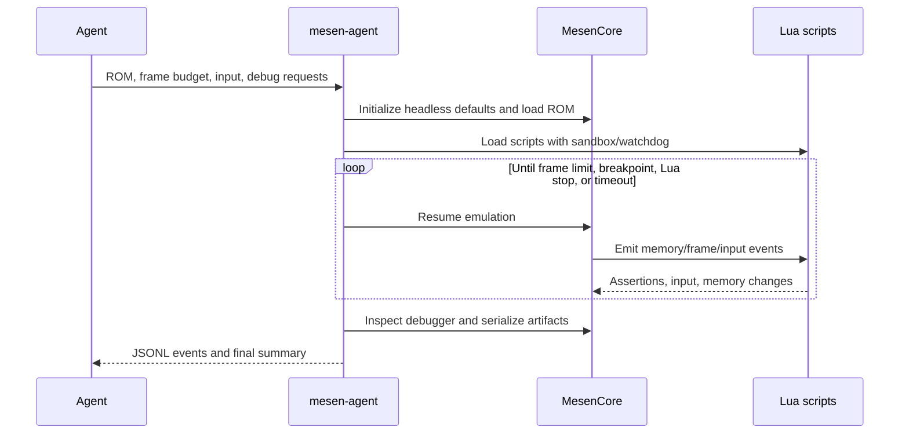

# mesen-agent

[](https://github.com/atonamy/mesen-agent/actions/workflows/build.yml)
[](https://github.com/atonamy/mesen-agent/releases/latest)
[](LICENSE)

`mesen-agent` is a native, windowless emulator, debugger, and evidence-capture
toolkit designed for AI coding agents. It lets an agent compile a ROM, run it
for a deterministic number of frames, drive controllers, execute Lua,
break/step through machine code, inspect or mutate memory, compare states, and
collect screenshots, gameplay video, audio, traces, and coverage without ever
opening Mesen's graphical interface.

The project is especially useful for agentic NES development: an AI can change
assembly or C code, build a `.nes`, exercise the exact behavior it changed,
inspect zero-page state and CPU execution, and return machine-readable evidence
in a single terminal loop. The same CLI also supports the other consoles in
Mesen's emulation core.

> [!NOTE]
> This is a focused fork of [SourMesen/Mesen2](https://github.com/SourMesen/Mesen2)
> around Mesen 2.1.1. The upstream repository is archived; current GUI-focused
> Mesen development continues at [nesdev-org/MesenCE](https://github.com/nesdev-org/MesenCE).
> This fork deliberately publishes `mesen-agent` CLI binaries, not the Mesen GUI.

## Install

### Fast install of the latest CLI release

Linux and macOS:

```sh
curl -fsSL https://raw.githubusercontent.com/atonamy/mesen-agent/master/Headless/install.sh | sh
```

The installer selects the current OS and CPU architecture, verifies the release
checksum, and installs the CLI and its matching runtime in `$HOME/.local/bin`.
Ensure that directory is on `PATH`:

```sh
export PATH="$HOME/.local/bin:$PATH"
mesen-agent --help
```

Windows PowerShell:

```powershell
irm https://raw.githubusercontent.com/atonamy/mesen-agent/master/Headless/install.ps1 | iex
```

This installs to `%USERPROFILE%\.local\bin`. Add that directory to `PATH`, or
invoke `mesen-agent.exe` by absolute path.

You can also download an archive directly from
[GitHub Releases](https://github.com/atonamy/mesen-agent/releases/latest).
Each release contains only `mesen-agent`, the matching Mesen core runtime,
licenses, and checksums—no Avalonia UI or .NET application.

### Install directly from a GitHub release

The release asset must match the host operating system and CPU:

| Host | Release asset |
|---|---|
| macOS Apple silicon | `mesen-agent-macos-arm64.tar.gz` |
| macOS Intel | `mesen-agent-macos-x64.tar.gz` |
| Linux arm64 | `mesen-agent-linux-arm64.tar.gz` |
| Linux x86-64 | `mesen-agent-linux-x64.tar.gz` |
| Windows x86-64 | `mesen-agent-windows-x64.zip` |

The following commands download from GitHub Releases, verify the published
checksum, and install into the location used by the agent skill.

macOS, automatically selecting Apple silicon or Intel:

```sh
INSTALL_DIR="$HOME/.local/bin"
WORK_DIR="$(mktemp -d)"
case "$(uname -m)" in
  arm64|aarch64) ASSET=mesen-agent-macos-arm64.tar.gz ;;
  x86_64|amd64) ASSET=mesen-agent-macos-x64.tar.gz ;;
  *) echo "Unsupported macOS architecture: $(uname -m)" >&2; exit 1 ;;
esac
BASE_URL=https://github.com/atonamy/mesen-agent/releases/latest/download
curl -fL "$BASE_URL/$ASSET" -o "$WORK_DIR/$ASSET"
curl -fL "$BASE_URL/SHA256SUMS" -o "$WORK_DIR/SHA256SUMS"
(cd "$WORK_DIR" && grep " $ASSET$" SHA256SUMS | shasum -a 256 -c -)
tar -xzf "$WORK_DIR/$ASSET" -C "$WORK_DIR"
mkdir -p "$INSTALL_DIR"
install -m 755 "$WORK_DIR/mesen-agent" "$INSTALL_DIR/mesen-agent"
install -m 755 "$WORK_DIR/MesenCore.dylib" "$INSTALL_DIR/MesenCore.dylib"
"$INSTALL_DIR/mesen-agent" --help
```

Linux, automatically selecting arm64 or x86-64:

```sh
INSTALL_DIR="$HOME/.local/bin"
WORK_DIR="$(mktemp -d)"
case "$(uname -m)" in
  arm64|aarch64) ASSET=mesen-agent-linux-arm64.tar.gz ;;
  x86_64|amd64) ASSET=mesen-agent-linux-x64.tar.gz ;;
  *) echo "Unsupported Linux architecture: $(uname -m)" >&2; exit 1 ;;
esac
BASE_URL=https://github.com/atonamy/mesen-agent/releases/latest/download
curl -fL "$BASE_URL/$ASSET" -o "$WORK_DIR/$ASSET"
curl -fL "$BASE_URL/SHA256SUMS" -o "$WORK_DIR/SHA256SUMS"
(cd "$WORK_DIR" && grep " $ASSET$" SHA256SUMS | sha256sum -c -)
tar -xzf "$WORK_DIR/$ASSET" -C "$WORK_DIR"
mkdir -p "$INSTALL_DIR"
install -m 755 "$WORK_DIR/mesen-agent" "$INSTALL_DIR/mesen-agent"
install -m 755 "$WORK_DIR/MesenCore.so" "$INSTALL_DIR/MesenCore.so"
"$INSTALL_DIR/mesen-agent" --help
```

Windows x64 PowerShell:

```powershell
$Asset = "mesen-agent-windows-x64.zip"
$BaseUrl = "https://github.com/atonamy/mesen-agent/releases/latest/download"
$WorkDir = Join-Path ([IO.Path]::GetTempPath()) ("mesen-agent-" + [guid]::NewGuid())
$InstallDir = Join-Path $HOME ".local\bin"
New-Item -ItemType Directory -Force $WorkDir, $InstallDir | Out-Null
Invoke-WebRequest "$BaseUrl/$Asset" -OutFile "$WorkDir/$Asset"
Invoke-WebRequest "$BaseUrl/SHA256SUMS" -OutFile "$WorkDir/SHA256SUMS"
$ChecksumLine = Get-Content "$WorkDir/SHA256SUMS" |
  Where-Object { $_ -match " $([regex]::Escape($Asset))$" }
if (-not $ChecksumLine) { throw "Checksum for $Asset was not published" }
$Expected = ($ChecksumLine -split '\s+')[0].ToLowerInvariant()
$Actual = (Get-FileHash "$WorkDir/$Asset" -Algorithm SHA256).Hash.ToLowerInvariant()
if ($Actual -ne $Expected) { throw "mesen-agent release checksum mismatch" }
Expand-Archive "$WorkDir/$Asset" -DestinationPath "$WorkDir/extracted" -Force
Copy-Item "$WorkDir/extracted/mesen-agent.exe" $InstallDir -Force
Copy-Item "$WorkDir/extracted/MesenCore.dll" $InstallDir -Force
& "$InstallDir/mesen-agent.exe" --help
```

Add `$HOME/.local/bin` to the shell `PATH` after installation, but keep the
binary and matching `MesenCore` library together in that directory.

### Install the AI-agent skill from GitHub

The repository uses the open Agent Skills layout, so the standard skills CLI
discovers and installs it directly from GitHub:

First verify that GitHub discovery finds the skill, then install it globally for
all supported coding agents:

```sh
npx --yes skills@latest add atonamy/mesen-agent --list
npx --yes skills@latest add atonamy/mesen-agent \
  --skill mesen-agent --agent '*' --global --yes
```

The second command installs the canonical copy under
`$HOME/.agents/skills/mesen-agent` and wires supported clients such as Codex,
Claude Code, and Pi to it. Verify the registrations with:

```sh
npx --yes skills@latest list --global --json
```

The skill lives at `skills/mesen-agent`, follows the portable `SKILL.md`
convention, always instructs agents to invoke
`$HOME/.local/bin/mesen-agent`, and includes the full CLI contract plus advanced
debugging examples.

### Prompt examples for coding agents

After installing the binary and skill, ask an agent to use the skill explicitly.
These prompts are designed to produce commands, machine-readable evidence, and
reproducible artifacts rather than opening a GUI.

Investigate why a game does not leave its title screen:

```text
Use the mesen-agent skill and $HOME/.local/bin/mesen-agent. Do not open any GUI.
Run build/game.nes in an isolated home, press Start deterministically, inspect
NES RAM before and after the input, and use Lua inputPolled callbacks if the
simple schedule is insufficient. Save JSONL events, a final screenshot, AVI,
WAV, and state JSON. Explain the exact state transition or why it failed.
```

Find and prove a gameplay regression:

```text
Use the mesen-agent skill to compare build/good.nes and build/bad.nes. Give each
run a separate --home directory and identical frame/input schedules. Compare
zero-page RAM, complete state JSON, screenshots, and traces. Locate the first
meaningful divergence and report exact commands and artifact paths.
```

Debug machine code at a suspected routine:

```text
Use the mesen-agent skill on build/game.nes. Set an execute breakpoint at NES
CPU address $C010, run until it hits, step one instruction, then return the PC,
call stack, nearby disassembly with opcode bytes, relevant RAM, and a bounded
trace. Confirm the final summary and do not infer success only from exit code.
```

Create a state-aware Lua test:

```text
Use the mesen-agent skill. Write and run a Lua test that reads NES internal RAM,
drives controller input from inputPolled, asserts the expected gameplay state,
checks a RAM write/read round trip, and exits nonzero on failure. Keep Lua IO and
network disabled unless the test genuinely requires them. Capture PNG, AVI,
WAV, save state, and JSONL evidence from $HOME/.local/bin/mesen-agent.
```

## Why this helps coding agents

Traditional emulator automation often stops at “launch the game and press some
keys.” That is not enough for autonomous debugging. An agent needs stable input,
structured observations, bounded execution, deep debugger control, and durable
artifacts it can compare between builds.

| Agent need | `mesen-agent` capability |
|---|---|
| Deterministic tests | Fixed relative frame budgets, isolated homes, explicit wall-clock watchdogs |
| Gameplay automation | Frame schedules and Lua state-dependent controller input |
| Program understanding | Breakpoints, stepping, disassembly, expressions, PC, call stacks, traces, CDL |
| State inspection | Memory reads/dumps, complete JSON state, save-state load/save |
| Controlled experiments | Memory writes, PC changes, Lua assertions, in-memory save-state round trips |
| Visual evidence | PNG screenshots and AVI/GIF gameplay capture |
| Audio evidence | Standalone WAV plus emulated audio in AVI |
| Reliable orchestration | JSON Lines stdout, explicit artifact paths, documented exit codes |
| Safe scripting | Lua IO/network disabled by default, callback watchdog, fail-fast errors |
| CI operation | No window, display server, host audio device, or interactive input backend |

An effective agent loop looks like this:



## Supported systems

ROM format selects the console automatically. Some systems or games require
firmware placed in the selected `--home` directory.

| System | Typical ROMs | Example CPU/memory types |
|---|---|---|
| NES / Famicom | `.nes`, `.fds`, `.nsf` | `Nes`, `NesMemory`, `NesInternalRam`, `NesPrgRom` |
| SNES / Super Famicom | `.sfc`, `.smc` | `Snes`, `SnesMemory`, `SnesWorkRam`, `SnesPrgRom` |
| Game Boy / Game Boy Color | `.gb`, `.gbc` | `Gameboy`, `GameboyMemory`, `GameboyWorkRam` |
| Game Boy Advance | `.gba` | `Gba`, `GbaMemory`, `GbaIntWorkRam`, `GbaVideoRam` |
| PC Engine / TurboGrafx-16 | `.pce` and CD images | `Pce`, `PceMemory`, `PceWorkRam`, `PceVideoRam` |
| Master System / Game Gear | `.sms`, `.gg` | `Sms`, `SmsMemory`, `SmsWorkRam`, `SmsPrgRom` |
| WonderSwan | `.ws`, `.wsc` | `Ws`, `WsMemory`, `WsWorkRam`, `WsPrgRom` |

Run `--frames 0 --list-memory --pc` on the actual ROM before assuming a memory
layout. Multi-CPU systems also require the correct `--cpu` for expressions,
stepping, disassembly, breakpoints, PC, and call-stack operations.

## Quick start

Inspect a newly built NES ROM without advancing emulation:

```sh
mesen-agent build/game.nes \
  --home /tmp/mesen-game-home \
  --frames 0 --list-memory --pc
```

Drive Start, run 300 frames, inspect zero page, and capture state and media:

```sh
mesen-agent build/game.nes \
  --home /tmp/mesen-game-home \
  --frames 300 --timeout 30 \
  --input '0:start@40-46' \
  --read-memory NesInternalRam:0:256 \
  --state-json artifacts/state.json \
  --screenshot artifacts/final.png \
  --video artifacts/gameplay.avi \
  --audio artifacts/audio.wav
```

Stop on an execute breakpoint, step one operation, and inspect the result:

```sh
mesen-agent build/game.nes \
  --home /tmp/mesen-break-home \
  --frames 10000 \
  --breakpoint 'NesMemory:0xC010:x' \
  --step 1 --pc --callstack \
  --disassemble 0xC000:32 \
  --read-memory NesInternalRam:0x20:32
```

Produce broad execution evidence:

```sh
mesen-agent build/game.nes \
  --home /tmp/mesen-trace-home \
  --frames 1800 \
  --trace artifacts/trace.log \
  --save-cdl NesPrgRom=artifacts/game.cdl \
  --dump-memory NesInternalRam=artifacts/ram.bin \
  --save-state artifacts/repro.mss
```

## Lua automation

`--lua FILE` loads Mesen debugger Lua before execution and is repeatable. Scripts
can observe memory/events, assert invariants, inject dynamic input, draw overlays,
take screenshots, create/load in-memory save states, rewind, step, or terminate
the run with `emu.stop(code)`.

Example state-aware NES test:

```lua
local polls = 0

emu.addEventCallback(function()
  local state = emu.read(0x0E, emu.memType.nesInternalRam)
  local shouldStart = state == 0 and polls >= 40 and polls <= 46
  emu.setInput({ start = shouldStart }, 0, 0)
  polls = polls + 1
end, emu.eventType.inputPolled)

emu.addEventCallback(function()
  local state = emu.read(0x0E, emu.memType.nesRam)
  if polls == 80 then
    assert(state == 2, "expected PLAY state")
    emu.log("PLAY reached with valid NES RAM reads")
  end
end, emu.eventType.endFrame)
```

`nesInternalRam` is the canonical physical 2 KiB NES system RAM type;
`nesRam` is a compatibility alias for FCEUX-style automation. `nesMemory`
addresses the CPU-visible bus. Invalid memory enum names fail immediately rather
than silently reading memory type zero.

Although `inputPolled` is the most precise event for controller automation,
explicit values passed to `emu.setInput()` from frame or memory callbacks are
queued for the next poll, so the core cannot erase them before the ROM samples
the controller.

Lua is sandboxed by default:

- add `--lua-allow-io` only for trusted scripts that need `io`, `os`, or sibling
  `require()` modules;
- add `--lua-allow-network` only for trusted scripts that need LuaSocket;
- use `--lua-timeout` to bound each callback;
- require `summary.ok == true` and every `lua_log.error_count == 0` before
  trusting script-derived conclusions.

## Output contract

Standard output is JSON Lines: one complete JSON object per line. Diagnostics
and usage errors go to stderr; binary artifacts only go to requested files.

```json
{"event":"loaded","rom":"/work/game.nes","console":"Nes","cpu":"Nes"}
{"event":"memory_read","type":"NesInternalRam","start":14,"length":1,"hex":"02"}
{"event":"screenshot_saved","file":"/work/final.png"}
{"event":"summary","ok":true,"reason":"frame_limit","frames_executed":80,"stop_code":0}
```

| Exit | Meaning |
|---:|---|
| `0` | Successful run |
| script code | Value supplied to `emu.stop(code)` |
| `2` | Invalid CLI arguments |
| `3` | ROM, runtime, or artifact failure |
| `4` | Overall wall-clock timeout |
| `5` | Lua load, callback, assertion, or watchdog failure |

Do not treat every nonzero code as a crash: first inspect the final `summary`
and determine whether Lua intentionally requested that status.

## Architecture

The CLI is intentionally thin. It does not reimplement an emulator or maintain
a second debugger. It calls a narrow native agent ABI in the same `MesenCore`
used by the desktop application, then converts observations into stable JSONL.



Execution follows a bounded, observable lifecycle:



## What changed from archived Mesen2

The guiding rule is “reuse the core, minimize the fork.” The changes are focused
at existing extension points instead of duplicating console implementations.

| Area | Change |
|---|---|
| Native frontend | Added `Headless/AgentCli.cpp` and native build targets; no Avalonia or .NET dependency |
| Native runtime | Agent builds omit unused SDL, X11, host-audio, and physical-input backends; capture stays inside `MesenCore` |
| Core ABI | Added small wrappers for frames, console/CPU discovery, state JSON, screenshots, Lua policy, and deterministic input schedules |
| Debugger | Exposed breakpoint, step, expression, PC, call-stack, disassembly, trace, CDL, and memory operations to the CLI |
| Lua reliability | Added fail-fast error counts, callback watchdog behavior, safe teardown, strict required memory arguments, and `nesRam` compatibility |
| Input timing | Added deterministic CLI schedules and queued off-poll Lua input so frame callbacks cannot lose controller changes |
| Media | Reused Mesen's renderer and recorders without initializing a window, host audio device, or interactive input backend |
| Video safety | Ensured the NES software video filter can render and capture frames without a GUI renderer |
| Automation | Added isolated homes, machine-readable summaries, complete state dumps, artifact paths, and bounded execution |
| Validation | Added a synthetic redistributable NES ROM and regression coverage for debug, state, Lua, input, sandboxing, and media |
| Distribution | Added agent-only macOS/Linux/Windows workflows, portable installers, checksums, and multi-agent skill packaging |

## Headless design guarantees

- No GUI window is created.
- No display server is required for capture.
- No host audio output device is opened; emulated audio can still be recorded.
- No keyboard, mouse, or physical controller backend is required.
- Maximum-speed execution is the default; `--no-max-speed` opts into pacing.
- Every independent run can use its own `--home` directory.
- A finite wall-clock timeout prevents wedged emulation or scripts.
- Lua IO and network capabilities are explicit trust-boundary expansions.
- Requested post-failure memory/state/screenshots remain available for diagnosis.

## Build and test

Linux and macOS need a C++17 compiler. The agent target deliberately excludes
the desktop SDL/display/audio/input backends, and does not need SDL2 or the .NET
SDK:

```sh
make agent -j4
bash Headless/tests/smoke.sh
```

Windows uses Visual Studio 2022:

```powershell
msbuild Mesen.sln -m -p:Configuration=Release -p:Platform=x64 -t:Headless
```

See [Headless/README.md](Headless/README.md) for the detailed native CLI guide,
[COMPILING.md](COMPILING.md) for platform prerequisites, and
[the skill CLI reference](skills/mesen-agent/references/cli-reference.md)
for the complete option/event contract.

The agent-only GitHub workflow builds and smoke-tests native release bundles on:

- macOS arm64 and Intel x64;
- Linux x64 and arm64;
- Windows x64.

Tags matching `v*` publish those verified bundles and `SHA256SUMS` as a GitHub
release. Workflow artifacts and release archives never contain the GUI app.

## GitHub support

- Report reproducible CLI problems in
  [Issues](https://github.com/atonamy/mesen-agent/issues).
- Attach the exact command, ROM SHA-1 from the `loaded` event, final `summary`,
  stderr, operating system/architecture, and relevant artifacts.
- Do not upload commercial ROMs or copyrighted firmware. Prefer a minimal
  homebrew reproduction or the synthetic test ROM generator.
- Pull requests should preserve headless operation and include a terminal-level
  regression in `Headless/tests` when behavior changes.

## License and attribution

Mesen and this fork are available under GPL-3.0-or-later. See [LICENSE](LICENSE).

Copyright (C) 2014–2026 Sour and Mesen contributors. Agent-focused changes are
maintained in this fork. This project is not affiliated with Nintendo or other
console manufacturers.
